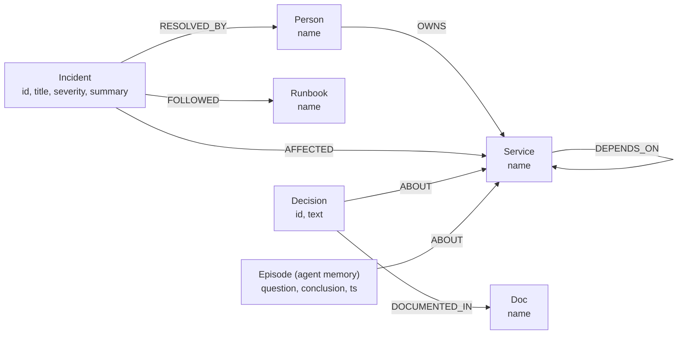
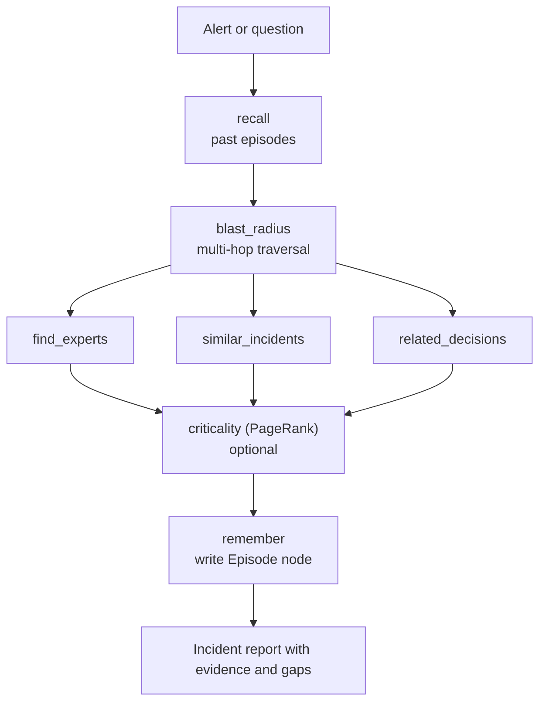

# BlastRadius

Graph-powered incident-response agent. Ask "paymentservice is failing, who do I page?" and get the blast radius, owners, past incidents, runbooks, and architecture decisions. Every fact comes from a **FalkorDB** graph traversal, shown live in a 3D graph with the Cypher behind each step.

- **Live demo:** `[https://blastradius-cyvg.onrender.com/]`
- **Demo video:** `[<your-video-url>](https://youtu.be/eRM70_uqc_A)`
- **Hackathon:** WeMakeDevs x FalkorDB, *Graph Hacks: Context for AI Agents*

## Why a graph

On-call questions are relationships, not documents: what depends on this service, who owns it, who fixed something like it, which decision applies. Plain search or RAG can't follow multi-hop chains like `frontend -> checkoutservice -> paymentservice`. A graph traversal does, and it returns the exact path as evidence.

## Graph map

### Nodes and relationships

| Node | Properties | Meaning |
|---|---|---|
| `Service` | `name` | A microservice or datastore (dependency graph modeled on Google's Online Boutique demo, plus extras) |
| `Person` | `name` | An engineer who owns services or resolved incidents |
| `Incident` | `id`, `title`, `severity`, `summary` | A past incident and how it was fixed |
| `Runbook` | `name` | The runbook followed during an incident |
| `Decision` | `id`, `text` | An architecture decision about a service |
| `Doc` | `name` | The ADR that documents a decision |
| `Episode` | `question`, `conclusion`, `ts` | The agent's memory of a past investigation |

Each tenant gets its own graph (`blastradius_<tenant>`). The data is synthetic (a fictional company called `acme`).

### How the agent queries the graph

The LLM never answers from its own knowledge. It calls seven tools, each a parameterized Cypher query or graph algorithm:

| Tool | Cypher pattern | Answers |
|---|---|---|
| `recall` | `(Episode)-[:ABOUT]->(Service {name})` | What did we conclude last time? |
| `blast_radius` | `(d:Service)-[:DEPENDS_ON*1..4]->(s:Service {name})` | Which services are impacted, and at what hop distance? |
| `find_experts` | `(Person)<-[:RESOLVED_BY]-(Incident)-[:AFFECTED]->(Service)` and `(Person)-[:OWNS]->(Service)` | Who owns it, and who has fixed it before? |
| `similar_incidents` | `(Incident)-[:AFFECTED]->(Service)`, `(Incident)-[:FOLLOWED]->(Runbook)`, `(Incident)-[:RESOLVED_BY]->(Person)` | What happened before, and which runbook worked? |
| `related_decisions` | `(Decision)-[:ABOUT]->(Service)`, `(Decision)-[:DOCUMENTED_IN]->(Doc)` | Which architecture decisions apply? |
| `criticality` | `CALL algo.pageRank('Service','DEPENDS_ON')` | Which services does everything else depend on? |
| `remember` | `CREATE (Episode)-[:ABOUT]->(Service)` | Store this conclusion for future sessions |

Example: `paymentservice is failing`
1. `blast_radius` returns `checkoutservice` (1 hop) and `frontend` (2 hops).
2. `find_experts` returns the owner Asha, plus Ben for `frontend`.
3. `similar_incidents` returns INC-101 and runbook `RB-payments-timeout`.
4. `related_decisions` returns DEC-1 / ADR-014: circuit breakers on all payment calls.
5. `remember` stores the conclusion, so the next session starts with `recall` finding it.

### Explainability in the UI

Each tool call streams to the browser with its Cypher, its raw result, and the node path it used. The 3D graph lights up that path: red for the affected service, orange for the blast radius, and blue for everything else a tool touched.

## Run it locally

1. Create a FalkorDB Cloud instance and copy `.env.example` to `.env`:
   `FALKORDB_HOST`, `FALKORDB_PORT`, `FALKORDB_USERNAME`, `FALKORDB_PASSWORD`, `FALKORDB_SSL`, `OPENROUTER_API_KEY`, `MODEL`
2. `pip install -r requirements.txt`
3. `python -m backend.seed --tenant acme`
4. `uvicorn backend.main:app --reload`
5. Open `http://localhost:8000`

## Stack

FalkorDB Cloud, Python client, FastAPI, OpenRouter (OpenAI-compatible tool calling), 3d-force-graph (Three.js) frontend.

## Notes

- The three sample questions in the UI replay cached results of real agent runs (`cache/`), so the demo works without API credits. Any other question runs the agent live.
- The free hosting tier sleeps when idle, so the first page load can take about a minute.

## AI assistance disclosure

Built with help from AI coding assistants (Claude) for scaffolding, Cypher drafting, frontend code, and debugging. The graph schema, queries, and agent design were reviewed and tested by the author.
